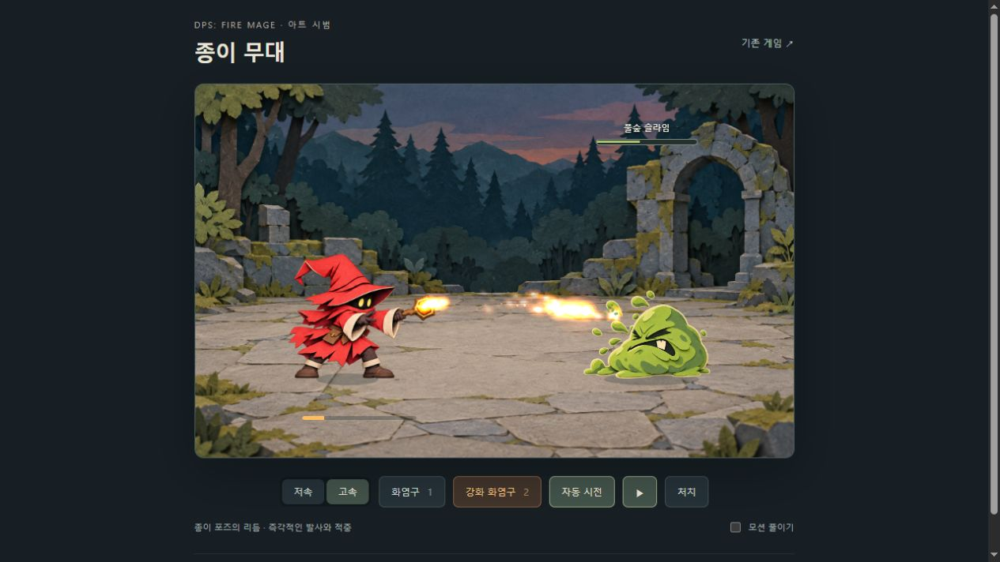

# 페이퍼크래프트 전투 시범 — 2026-10-06

## 최종 범위

`paper-preview.html`에서 마법사·슬라임·배경만 종이 재질로 비교합니다. 사용자 피드백에 따라 화염구와 착탄 화염은 기존 `combat-art.js`의 파티클 렌더러를 그대로 재사용합니다. 종이 화염구 생성 후보는 채택하지 않았습니다.

시범은 독립 비교 화면이며, 현재 실제 `index.html`에도 같은 마법사·슬라임 렌더러와 종이 몬스터를 연결했습니다. 전체 적용 범위와 검증은 `PAPER_MONSTERS.md`를 기준으로 확인합니다. 시범 자체는 게임의 수치·저장 데이터를 변경하지 않습니다. 저속은 1.5초, 고속은 현재 게임의 최소 화염구 시전시간에 맞춘 0.35초입니다. 강화 버튼은 비교용 즉시 발사이며 실제 프록 판정을 재현하지 않습니다.

마법사는 대기·준비·발사·반동 4포즈, 슬라임은 대기·호흡·피격·복원 4포즈입니다. 포즈 교체와 발 원점 기준 미세 회전으로 구성하며 부위별 관절 리깅이나 새로 그린 중간 프레임은 아닙니다. 포즈 간 혼합과 실시간 전신 스프링 변형을 제거했습니다. 대기 회전은 12fps로 샘플링하고 실제 발사·적중 사건은 샘플링을 기다리지 않습니다.

투사체 상한 8개, 점액 조각 24개, 기존 화염 입자 최대 170개입니다. 일시정지·결과창·탭 비활성 상태에서 전투와 효과 시간을 멈춥니다. 처치 후 1.1초를 두고 결과창을 띄우며 배경을 어둡게 하고 탄성 등장합니다. 모션 감소에서는 미세 회전·처치 접힘·추가 조각·화염 꼬리를 줄이며 발사와 적중은 유지합니다.

## 직접 확인한 레퍼런스

- [닌텐도 공식 Paper Mario: The Origami King 소개](https://www.nintendo.com/ph/switch/aruu/index.html): 브라우저에서 대표 이미지를 직접 확인했습니다. 평평한 캐릭터 가장자리와 접힌 입체 종이 소품이 공존하며 배경은 여러 깊이로 분리됩니다. 원화에는 얇은 종이 단면, 층별 좁은 그림자, 채도 차이를 반영했습니다. 예고편은 재생 검토하지 않았으며 영상 타이밍을 관찰했다고 주장하지 않습니다.
- [닌텐도 공식 디오라마 제작 자료](https://play.nintendo.com/documents/Paper_Mario_Origami_King_PlayNintendo_diorama.pdf): 잘라낸 캐릭터를 접은 지지대와 팝업 면에 세우는 제작 설명을 확인했습니다. 배경을 정적인 종이 무대로 해석하는 참고입니다.
- [IIT Bombay / D’Source 컷아웃 제작 과정](https://www.dsource.in/course/cut-out-animation/cutout-manual-method/stages/production): 브라우저에서 실제 종이 조각을 배치한 연속 사진을 확인했습니다. 고정된 카메라, 부품 재배치, 프레임별 촬영을 안내합니다. 포즈를 잠깐 유지한 뒤 전환하고 장면 전체를 흔들지 않는 방식에 반영했습니다. 재생 영상이 아닌 제작 연속 사진입니다.
- [닌텐도 개발자 인터뷰](https://play.nintendo.com/news-tips/news/mario-luigi-paper-jam-developer-questions-answers/): 종이 캐릭터의 특성을 상황별 행동에 연결한다는 설명을 참고했습니다.

레퍼런스 에셋은 복사하지 않았습니다. 원화는 기존 게임 캐릭터를 참고하여 내장 이미지 생성 도구로 새로 제작했습니다.

## 채택 에셋과 렌더링 메타데이터

- `assets/art/paper-mage-poses.png`: 붉은 마법사 2×2 포즈, 1254×1254, 투명 PNG.
- `assets/art/paper-slime-poses.png`: 녹색 슬라임 2×2 포즈, 1254×1254, 투명 PNG.
- `assets/art/paper-arena.png`: 종이 숲 폐허 무대, 1536×1024.
- `paper-art.js`: 실제 원화의 표시 영역·발 원점·지팡이 끝 좌표. 같은 배우의 포즈마다 동일한 축척을 사용합니다.

원화의 마법사 발사 지팡이가 옆 칸에 침범한 첫 후보를 폐기하고 여백을 확보하도록 재생성했습니다. 슬라임의 셀 경계 근처 장식이 인접 포즈에 섞이지 않도록 표시 영역을 검수했습니다.

## 사용 프롬프트

내장 `image_gen` 도구를 사용했습니다. 프롬프트의 영문은 도구에 보낸 원문을 보존합니다.

### 마법사 최초 생성

Use case: style-transfer. Production game sprite atlas: exactly FOUR equal cells in a 2 columns by 2 rows layout, square 1024x1024 canvas, transparent background. Reference image is CHARACTER IDENTITY only, not rendering style. Reinterpret this same small red bent-hat fire mage as a handcrafted flat layered colored-paper cutout puppet: burnt coral red paper robe and crooked oversized pointed hat, charcoal featureless face with two yellow oval paper eyes, ivory cuffs, tiny brown boots, short crooked wooden-colored paper staff with amber paper gem. Clearly visible thin cream cardstock cut edges, fine matte fibers, crisp simple cut shapes and subtle occlusion shadows between stacked paper pieces. Flat frontal cutout seen facing RIGHT, not a folded 3D origami sculpture, not ink comic drawing, no luminous halos. Each cell same puppet proportions and same grounded boots position at x=210 y=450 within its 512 square cell. Entire character including staff must fit inside each cell with 35px clear padding. Top left IDLE relaxed staff diagonally up toward right. Top right ANTICIPATION arm folds inward, staff pulled back, slight upper body lean back, feet remain planted. Bottom left RELEASE sleeve and staff extend horizontally right, small torso lean with both boots planted, staff gem at x=465 y=245 inside this cell. Bottom right RECOIL sleeve and staff fold toward chest, hat tip slightly trailing, both boots planted. All four visibly distinct poses while same head size and costume. Minimal detail, charming slightly fierce fantasy mage. No text, no labels, no cell boundaries, no scenery, no shadows outside puppet, no flame outside staff, actual transparent empty space.

### 마법사 여백 수정

Edit this 2x2 paper mage animation atlas. Keep EXACT character identity, excellent layered paper texture, colors and pose order. Production correction: EVERY puppet including ALL of its staff and gem must fit strictly in its own quarter cell with 35 pixels transparent margin on ALL sides. In particular BOTTOM LEFT release staff is crossing into bottom right cell: shrink ALL four puppets uniformly by 20 percent and SHORTEN release staff so entire bottom left silhouette fits. Leave broad transparent gaps between rows and columns. Same head size across four poses, same both boots floor line at 88 percent of each cell height. Each pose centered inside its cell, no overlaps. Remove isolated colored flecks in empty alpha, no haze. Transparent background. NO labels, grid or backdrop. Preserve four poses and papercraft appearance.

### 슬라임

Use case: style-transfer. Asset: game animation atlas, 1024x1024, exactly 2x2 cells of 512 pixels, genuine transparent background. Reference is monster identity only. Same chunky pear shaped olive/lime green slime with angry eyebrows, pale yellow eyes and one ivory tooth facing LEFT, reinterpret as charming handcrafted layered COLORED PAPER CUTOUT. Flat matte fibrous green paper shapes stacked, subtle narrow shadows between layers, thin cream cardstock cut edge, simplified bold readable silhouette, NO black ink outlines, NO glossy jelly, NO ambient glow. Four complete distinct poses: top left IDLE tall pear silhouette; top right REST lower/wider breathing silhouette, same volume; bottom left HIT squashed slightly to right, face scrunched, few small green cut-paper droplets close to body; bottom right RECOVER slight overshoot tall silhouette. All cells have centered floor contact at x=256 y=448, consistent overall scale, complete shape within x=75..437 and y=70..448 with generous transparent margins. Render paper material naturally, not origami angular sculpture. No text, labels, grids, background or cast shadow.

### 배경

Use case: stylized-concept. Asset type: background plate for original fantasy game paper-cutout combat prototype. 1536x1024 landscape. A handcrafted miniature PAPER DIORAMA of an ancient mossy stone courtyard in a forest at dusk, camera straight-on slightly above stage floor, not overhead. Three visible depth planes made of matte colored cardstock, crisp hand-cut shapes, fine paper fibers, thin cream cut edges and restrained shadows between layers. Far backdrop muted desaturated dark teal forest silhouettes; middle plane simple mossy blue-slate ruined stone arch at right and low chunky stone wall at left, with sparse paper shrubs at outer edges. Bottom 40 percent is a broad quiet light warm-gray cardstock stone floor receding gently, continuous unobstructed floor line at 78 percent height where two characters can stand. Central 60 percent width absolutely empty, uncluttered combat space. Muted dusk blues, teal, moss olive, warm gray floor, restrained contrast so red mage and orange fire stand out. Physical paper craft readability, simple big shapes, not glossy painting, not ink comic, not photoreal objects. NO characters, monsters, flames, braziers, UI, text, logos or ornate trims.

## 검증

- `node paper-preview.test.cjs`: 발사 동기화, 강화 즉시 발사, 저속·고속, 반복 효과 상한, 효과 소멸, 일시정지, 모션 감소, 처치 후 1.1초 지연과 모달 정지.
- 브라우저 실제 조작: 저속·고속 연사, 강화 즉시 발사, 발 원점과 바닥 접지, 시전바·체력 표시 확인. 고속과 강화 혼합 중 투사체 최대 3개, 화염 입자 60개를 관찰했으며 기존 상한 안에 있었습니다.
- 일시정지 전후 전투 시간 44.93초와 투사체·입자 수가 동일하게 유지됨을 확인했습니다. 결과창에서도 전투 시간 53.35초가 유지됐습니다.
- 모션 감소를 켜면 추가 점액 조각과 화염 꼬리가 0개로 줄고 적중은 계속 진행됐습니다.
- 처치 직후 결과창이 없는 여운 구간을 확인한 뒤 암전과 결과창, 다시 시작 동작을 확인했습니다.
- 390×844 모바일 화면에서 배우·시전바·체력바·조작 버튼과 모션 감소 설정이 잘리지 않고 표시됐습니다. 검증 후 브라우저 크기를 복원했습니다.
- 브라우저 경고·오류 없음. 기존 마법사·몬스터 모션 및 만화 에셋 테스트도 통과했습니다. 이 목록은 독립 시범 검증 기록입니다. 실제 게임 연결 검증은 `PAPER_MONSTERS.md`에 별도 기록했습니다. 장시간 성능 측정은 하지 않았습니다.
