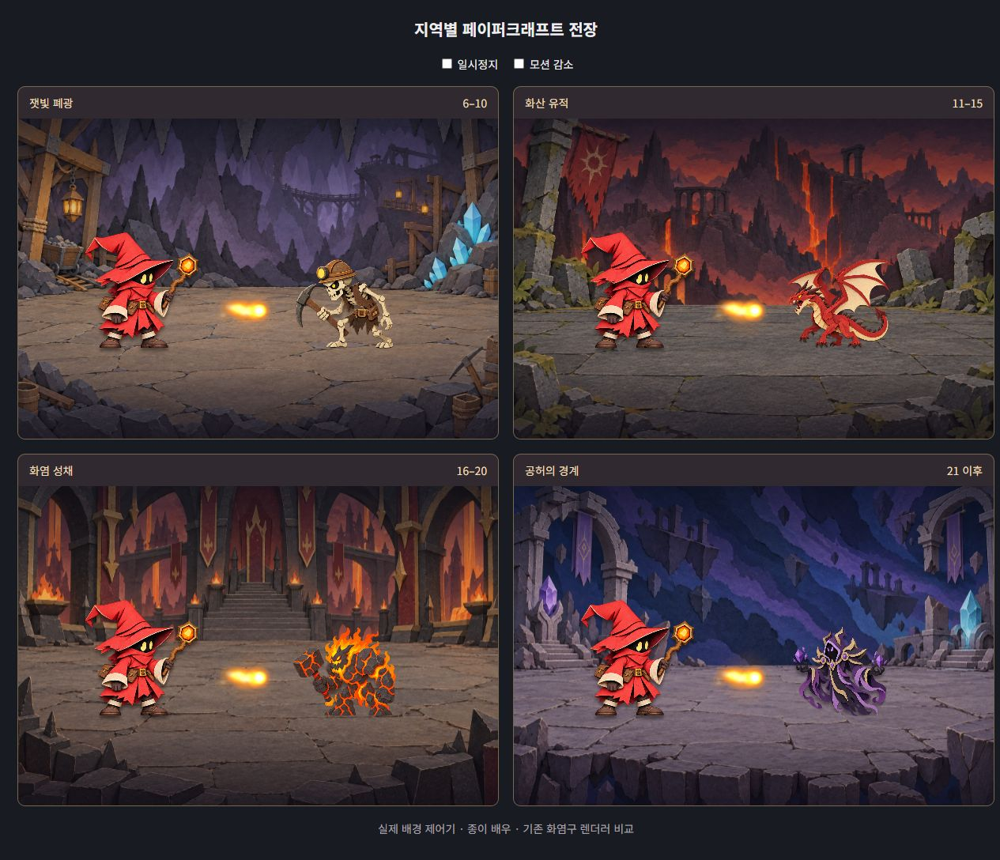

# 전 지역 페이퍼크래프트 배경 — 2026-10-06

## 현재 적용

실제 `index.html`에서 모든 지역 배경을 종이 무대로 통일했습니다. `arena-environment.js`의 이미지 경로만 새 원화로 바꾸고 기존 단계 선택·저장 복원·0.9초 전환·모달 정지·모션 감소·정적 렌더링 규칙을 유지합니다. `game.js`와 전투 파티클은 수정하지 않았습니다.

| 스테이지 | 지역 | 현재 원화 |
|---|---|---|
| 1~5 | 황혼의 초원 | `assets/art/paper-arena.png` |
| 6~10 | 잿빛 폐광 | `assets/art/paper-arena-mine.png` |
| 11~15 | 화산 유적 | `assets/art/paper-arena-ruins.png` |
| 16~20 | 화염 성채 | `assets/art/paper-arena-citadel.png` |
| 21 이후 | 공허의 경계 | `assets/art/paper-arena-void.png` |

새 원화 4장은 모두 1536×1024 RGB PNG입니다. 기존 `arena-*.png`는 이전 원화로 보존하며 게임은 새 경로를 사용합니다. 배경 제어기 스크립트의 버전을 갱신해 이전 경로가 캐시되지 않게 했습니다. `paper-arena-preview.html`은 실제 배경 제어기를 사용하는 검수 화면입니다. 비교용 정지 배우와 화염구를 겹치며 게임 저장 데이터나 실제 딜사이클은 사용하지 않습니다.

## 참고와 적용 판단

- [닌텐도 공식 Paper Mario 소개](https://www.nintendo.com/ph/switch/aruu/index.html)와 [원본 화면](https://www.nintendo.com/ph/switch/aruu/img/cal_img01.jpg): 앞선 작업에서 실제 브라우저로 확인한 자료를 재사용했습니다. 밝은 종이 단면, 평면 배우와 접힌 입체 건축물의 공존, 층별 그림자를 기준으로 배경의 재질을 맞췄습니다. 영상 재생을 새로 확인한 것으로 보고하지 않습니다.
- [닌텐도 공식 디오라마 제작 PDF](https://play.nintendo.com/documents/Paper_Mario_Origami_King_PlayNintendo_diorama.pdf): 제작 원문을 다시 열어 종이 바닥을 반으로 접고 팝업 면에 잘라낸 소품을 세우는 설명을 확인했습니다. 배경을 전경·중경·원경의 종이 면으로 나누는 구도에 반영했습니다.
- 기존 폐광·유적·성채·공허 원화와 채택한 초원 종이 무대를 모두 직접 열어 비교했습니다. 기존 원화는 지역 실루엣과 색의 참고, 초원 무대는 재질 참고로 사용했습니다. 외부 에셋을 복사하지 않았습니다.

폐광은 보라 암벽·황동 등불·파랑 접힌 수정, 화산 유적은 회색 석판·겹친 붉은 절벽, 성채는 큰 접힌 아치·어두운 붉은 깃발·절제된 용암, 공허는 남색·보라색 종이 하늘·부유 유적을 사용합니다. 전투 중앙과 배우의 72% 접지선에는 소품을 두지 않습니다. 바닥은 중간 명도의 무광 종이 석판을 유지해 붉은 마법사와 기존 주황 화염구가 읽히도록 합니다. 추가 배경 조명·움직이는 소품·파티클은 넣지 않습니다.

## 검증과 한계

- `node arena-environment.test.cjs`: 모든 페이즈 경계·무한 구간·역주행·초원 복귀, 다섯 종이 원화 경로, 정적 유지, 0.9초 전환, 모달 정지·모션 감소, 로드 지연·크기 변경·캐시 5개 제한 통과.
- 새 원화 4장의 크기·형식 확인, JavaScript 구문 검사와 Git 공백 검사 통과.
- 브라우저에서 실제 배경 제어기로 네 지역을 모두 표시했고 `mine/ruins/citadel/void`와 로딩 완료 상태를 확인했습니다. 종이 배우·기존 화염구를 겹친 화면에서 접지·중앙 여백·대비를 검수했습니다. 브라우저 오류·경고가 없었습니다.
- 검수 화면에서 일시정지와 모션 감소 조작을 확인했습니다. 전환 중 정지 동작은 배경 제어기 테스트로 확인했습니다.
- 390×844 좁은 화면에서 검수 카드가 한 열로 바뀌고 가로 넘침이 없음을 확인했으며 브라우저 크기를 복원했습니다. 이 검수 화면은 실제 게임의 모바일 HUD 배치를 검증한 것이 아닙니다.
- 모든 후반 스테이지를 실제 전투 진행으로 통과한 검증과 장시간 성능 측정은 하지 않았습니다. 파일 직접 실행은 이전에 확인된 검증 브라우저 정책 때문에 HTTP 경로로 검수했습니다. 신규 이미지에는 fetch·픽셀 읽기가 필요하지 않습니다.

## 생성 프롬프트 원문

내장 `image_gen` 도구를 사용했고 네 요청 모두 불투명 전체 배경입니다. 입력 1은 해당 기존 지역 원화, 입력 2는 `paper-arena.png`입니다. 영문은 실제 도구 프롬프트를 보존합니다.

### mine

Use case: style-transfer. Asset type: complete opaque background plate for a compact fantasy paper-cutout combat game, 1536x1024 landscape. Input image 1 is ONLY location identity/composition reference, NOT its ink illustration style. Input image 2 is the existing project's MATERIAL STYLE reference: handmade miniature paper diorama, matte fibrous colored cardstock, crisp hand-cut layered silhouettes, thin cream cut edges, subtle narrow shadows between physical layers, folded paper stone props. Reinterpret the location fully in this same material. Straight-on camera slightly above stage floor, same perspective as input 2. Three distinct depth planes, no realistic digital painting, no heavy black comic outlines, no glossy toy render. Bottom 42 percent is a broad quiet continuous stone-paper stage floor with simple large slabs, completely empty fighting space across central 65 percent width. Floor begins around y=58 percent, actor feet can stand at y=72 percent with no obstructing foreground props. Architecture/landmarks confined to upper field and extreme outer edges, sparse large readable shapes. Detailed materials but restrained object count. NO characters, monsters, UI, text, labels or watermarks. Background must let red mage and orange spell particles read clearly. Specific location: A deep abandoned mine cavern. Muted dusty lavender and charcoal rock paper layers recede into distance. One modest timber support and warm amber paper lantern at extreme left; a small mine cart partly behind it. A cluster of folded cyan-blue paper mineral crystals at extreme right, restrained brightness. Sparse simple hanging paper stalactites at top; a far dark wooden bridge as small quiet silhouette high behind. Warm gray-brown cardstock stone floor, medium value, matte. Keep center broad, quiet and unobstructed. No luminous haze or sparkling crystal particles.

### ruins

Use case: style-transfer. Asset type: complete opaque background plate for a compact fantasy paper-cutout combat game, 1536x1024 landscape. Input image 1 is ONLY location identity/composition reference, NOT its ink illustration style. Input image 2 is the existing project's MATERIAL STYLE reference: handmade miniature paper diorama, matte fibrous colored cardstock, crisp hand-cut layered silhouettes, thin cream cut edges, subtle narrow shadows between physical layers, folded paper stone props. Reinterpret the location fully in this same material. Straight-on camera slightly above stage floor, same perspective as input 2. Three distinct depth planes, no realistic digital painting, no heavy black comic outlines, no glossy toy render. Bottom 42 percent is a broad quiet continuous stone-paper stage floor with simple large slabs, completely empty fighting space across central 65 percent width. Floor begins around y=58 percent, actor feet can stand at y=72 percent with no obstructing foreground props. Architecture/landmarks confined to upper field and extreme outer edges, sparse large readable shapes. Detailed materials but restrained object count. NO characters, monsters, UI, text, labels or watermarks. Background must let red mage and orange spell particles read clearly. Specific location: Ancient volcanic ruins outdoors at dusk. Far backdrop layered dark plum and muted brick-red jagged mountains; narrow ember-orange paper lava ribbons deep in distance, modest brightness. Broken slate paper columns and one torn muted crimson paper banner at extreme left, low broken stone arch remnants at extreme right. Broad warm-gray charcoal cardstock stone floor with few large slabs, NO lava flowing across combat space and no bright cracks under actors. Lava forms cut orange shapes only at distant edges, not full-screen lighting. Muted cool gray floor contrasts orange live fire particles. Central depth plane open and uncluttered.

### citadel

Use case: style-transfer. Asset type: complete opaque background plate for a compact fantasy paper-cutout combat game, 1536x1024 landscape. Input image 1 is ONLY location identity/composition reference, NOT its ink illustration style. Input image 2 is the existing project's MATERIAL STYLE reference: handmade miniature paper diorama, matte fibrous colored cardstock, crisp hand-cut layered silhouettes, thin cream cut edges, subtle narrow shadows between physical layers, folded paper stone props. Reinterpret the location fully in this same material. Straight-on camera slightly above stage floor, same perspective as input 2. Three distinct depth planes, no realistic digital painting, no heavy black comic outlines, no glossy toy render. Bottom 42 percent is a broad quiet continuous stone-paper stage floor with simple large slabs, completely empty fighting space across central 65 percent width. Floor begins around y=58 percent, actor feet can stand at y=72 percent with no obstructing foreground props. Architecture/landmarks confined to upper field and extreme outer edges, sparse large readable shapes. Detailed materials but restrained object count. NO characters, monsters, UI, text, labels or watermarks. Background must let red mage and orange spell particles read clearly. Specific location: Interior of imposing fire citadel. Very tall charcoal-maroon folded-cardstock arches frame outer left/right, restrained dull gold paper trims, sparse hanging dark red paper banners. Far center high above stage: small throne alcove silhouette and distant stairs, subdued and never overlapping fighting floor. Narrow muted ember orange paper panels suggesting lava beyond side arches, not large bright firefalls. Broad neutral gray-brown layered cardstock floor, quiet and empty, no lava seams under actors. Massive folded paper stone construction, simple large shapes, restrained orange brightness so active spells remain strongest.

### void

Use case: style-transfer. Asset type: complete opaque background plate for a compact fantasy paper-cutout combat game, 1536x1024 landscape. Input image 1 is ONLY location identity/composition reference, NOT its ink illustration style. Input image 2 is the existing project's MATERIAL STYLE reference: handmade miniature paper diorama, matte fibrous colored cardstock, crisp hand-cut layered silhouettes, thin cream cut edges, subtle narrow shadows between physical layers, folded paper stone props. Reinterpret the location fully in this same material. Straight-on camera slightly above stage floor, same perspective as input 2. Three distinct depth planes, no realistic digital painting, no heavy black comic outlines, no glossy toy render. Bottom 42 percent is a broad quiet continuous stone-paper stage floor with simple large slabs, completely empty fighting space across central 65 percent width. Floor begins around y=58 percent, actor feet can stand at y=72 percent with no obstructing foreground props. Architecture/landmarks confined to upper field and extreme outer edges, sparse large readable shapes. Detailed materials but restrained object count. NO characters, monsters, UI, text, labels or watermarks. Background must let red mage and orange spell particles read clearly. Specific location: The edge of the cosmic void. Far backdrop is physically layered indigo, midnight-blue and muted violet cardstock swirl clouds, overlapping broad cut arcs, not painted galaxy photographs and not hundreds of stars. A few suspended paper stone silhouettes far above. Broken folded gray-lavender paper arches at extreme left and right, sparse muted purple banner; a small pale cyan folded crystal at right and violet at left, restrained brightness. A wide flat gray-lavender cardstock stone platform covers bottom 42 percent with medium-value slabs and a simple thick layered-paper cut front edge visible only at very bottom. Quiet unobstructed center, no bright center vortex or glowing actor-floor patterns.
