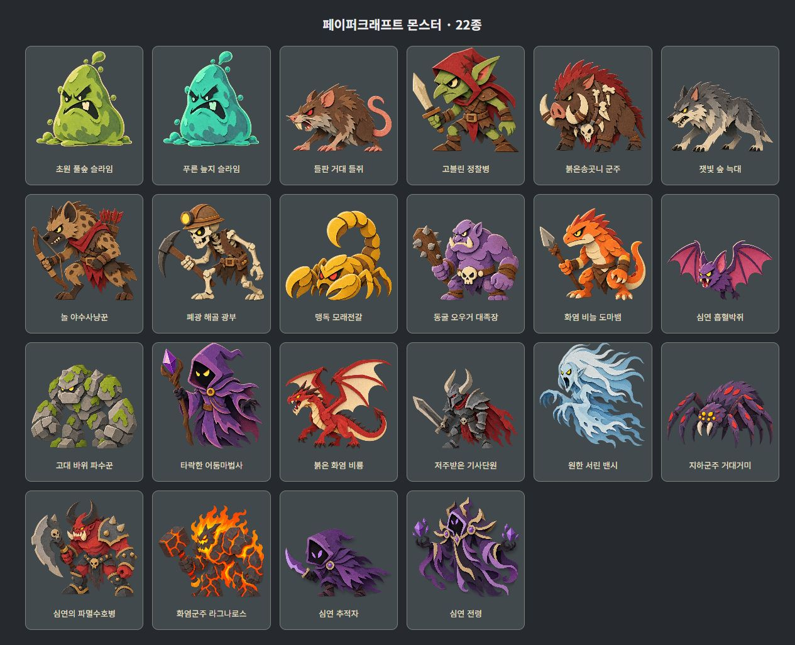

# 전체 몬스터 페이퍼크래프트 적용 — 2026-10-06

## 적용 범위

실제 진입 파일 `index.html`에 마법사·초반 슬라임·나머지 18종·무한 심연 2종을 연결했습니다. 총 22가지 몬스터 모습입니다. `game.js`와 `combat-art.js`는 수정하지 않았으며 기존 화염구·착탄·점액 파티클을 유지합니다. 현재 모든 지역 배경도 종이 원화로 연결했습니다. 지역별 원화와 검증은 `PAPER_ARENAS.md`를 참고합니다.

마법사와 슬라임은 각각 4장의 원화 포즈를 교체합니다. 다른 몬스터는 종이 원화 1장과 CSS 정지 자세·반동·사망 변형을 사용합니다. 독립 관절 애니메이션이나 몬스터별 새 중간 프레임을 제작한 것은 아닙니다. 단단한 재질의 탄성 압축은 제거하고, 생물·갑각·뼈·바위·갑옷·영체·화염의 사망 분기는 유지합니다. 도트 타격의 작은 반응과 기존 효과 개수 제한, 모션 감소 설정을 존중합니다.

## 참고 조사와 적용

- [닌텐도 공식 Paper Mario 소개와 화면](https://www.nintendo.com/ph/switch/aruu/index.html): 공식 원본 [이미지](https://www.nintendo.com/ph/switch/aruu/img/cal_img01.jpg)를 브라우저에서 직접 열어 확인했습니다. 평평한 캐릭터의 밝은 단면, 접힌 입체 주변 소품, 겹친 종이 그림자를 관찰했습니다. 몬스터에는 얇은 크림색 단면·무광 섬유·색종이 조각의 좁은 층 그림자를 반영했습니다. 영상은 이번에 재생 확인하지 않았습니다.
- [IIT Bombay / D’Source 제작 과정](https://www.dsource.in/course/cut-out-animation/cutout-manual-method/stages/production): 앞선 시범에서 직접 확인한 연속 제작 사진을 재사용하고 원문 설명을 다시 확인했습니다. 고정 카메라와 프레임별 조각 재배치, 12/24fps 촬영을 설명합니다. 부드러운 전신 젤리 변형을 줄이고 핵심 자세를 유지하는 리듬에 반영했습니다. 이번 원본 사진 재접속은 캐시 오류로 실패했으며 새 영상을 본 것으로 보고하지 않습니다.

원본 게임의 몬스터 색·무기·성격을 참고했으며 닌텐도 에셋은 복사하지 않았습니다. 생성과 편집은 내장 `image_gen` 도구를 사용했습니다.

## 저장 에셋과 연결

- `assets/art/paper-monsters-field-v3.png`: 들쥐·고블린·멧돼지·늑대·놀·해골.
- `assets/art/paper-monsters-depth.png`: 전갈·오우거·도마뱀·박쥐·바위 파수꾼·어둠마법사.
- `assets/art/paper-monsters-boss.png`: 비룡·기사·밴시·거미·파멸수호병·화염군주.
- `assets/art/paper-monsters-abyss.png`: 심연 추적자·전령.
- `paper-monster-frames.js`: 실제 PNG 알파 채널을 분석한 20종 표시 영역·윤곽. 원본 PNG 픽셀은 수정하지 않습니다. 길게 뻗은 날개·무기가 인접 배우와 섞이지 않도록 개별 윤곽을 사용합니다.
- `paper-art.js`: 마법사·슬라임 포즈 좌표의 공통 원본. 별도 JSON 요청을 제거해 파일 직접 실행에서 데이터를 불러오기 위한 HTTP 요청이 필요 없습니다.
- `comic-assets.js`: 단계별 원화와 심연 일반/보스 선택.
- `monster-motion.js`, `art.css`: 종이 압축 차단과 사망용 외곽/원화 윤곽 분리.
- `monster-motion-preview.html`: 22가지 모습의 일반·강화 타격·사망 비교.
- `paper-monster-gallery.html`: 전체 원화 검수 화면.

첫 묶음에서 장비 여백을 좁게 만든 후보를 수정했습니다. 생성 도구의 출력 미리보기는 투명 RGB 영역까지 배경처럼 표시했지만 PNG의 알파 채널을 검사해 실제 투명 배경임을 확인했습니다. 코드에서는 PNG 그대로 알파 합성합니다. 첫 적용에서는 두 번째 여백 수정 후보를 사용했지만, 사용자 선택에 따라 세 번째 후보로 교체했습니다. 현재 원화는 `paper-monsters-field-v3.png`이며 표시 윤곽도 다시 분석했습니다. 두 번째 후보는 기존 파일에 보존했습니다.

## 검증

- 원화 전체 갤러리에서 22종을 실제 표시해 날개·무기·꼬리와 투명 배경을 확인했습니다.
- 비교 화면에서 비룡·바위 파수꾼·심연 전령 원화와 사망 연결을 확인했습니다. 12개 대표 단계의 강화 타격을 실제 버튼으로 실행해 종이 압축 0, 피격 steps(2), 대기 steps(3) 적용과 브라우저 오류 없음을 확인했습니다.
- 실제 `index.html`을 같은 로컬 HTTP 경로에서 열어 종이 마법사·고블린과 기존 자동 화염구 전투, 상세 창의 모션 정지를 확인했습니다. 브라우저 오류·경고가 없었습니다.
- `paper-monster-frames.test.cjs`: 원화 경계·심연 선택·종이 피격 압축 0·사망 시 원화 윤곽 보존·파티클 48개 제한.
- `comic-assets.test.cjs`, `mage-motion.test.cjs`, `monster-motion.test.cjs`, `arena-environment.test.cjs`, `paper-preview.test.cjs` 통과.
- 파일 직접 실행은 검증 브라우저의 file:// 정책 때문에 직접 화면을 열지 못했습니다. 동일한 진입 파일의 HTTP 실행을 확인했으며 fetch나 픽셀 읽기가 필요한 데이터 경로는 추가하지 않았습니다.
- 모든 후반 스테이지의 실제 게임 진행과 장시간 고속 연사 성능은 측정하지 않았습니다. 시범의 저속·고속·모션 감소·일시정지 검증과 실제 게임 연결 검증은 구분합니다.

## 생성 프롬프트 원문

영문은 내장 도구에 전달한 프롬프트를 보존합니다.

### paper-monsters-field

Use case: style-transfer. Production game sprite atlas, EXACTLY six different monsters arranged in 3 equal columns by 2 equal rows on 1536x1024 canvas, real transparent background. The only input image is a MATERIAL STYLE reference: matte fibrous layered colored cardstock, crisp hand-cut silhouettes, thin cream cut edges, restrained narrow shadows between overlapping paper pieces, charming handmade paper-cutout puppets. All face LEFT toward the player, entire body/equipment/wings/tail visible inside individual cell with at least 45px empty margins. One monster per cell, no overlap, no background, no external glow or ground shadow. Strong readable fantasy enemy shapes at small gameplay size. Flat frontal/three-quarter cut-paper actors, NOT glossy 3D sculptures, NOT comic ink outlines. Consistent material with slime reference. Heads, limbs, clothing are clearly separate stacked paper shapes. Ground contact is at 88 percent of each 512px cell height. Flying monsters hover modestly above same baseline. No text, labels, grid lines, decorations or other characters. Specific cell content:  TOP LEFT: brown giant field rat with pink curled tail, red eye, ragged fur. TOP MIDDLE: green goblin scout wearing red hood and brown leather, holding short ivory sword. TOP RIGHT: massive brown boar chieftain with crimson bristle mane, huge ivory tusks and bone ornaments. BOTTOM LEFT: gray forest wolf with ivory muzzle and yellow eye. BOTTOM MIDDLE: tawny hyena gnoll hunter in ragged red scarf and leather gear, holding a bow with red arrows in quiver. BOTTOM RIGHT: ivory skeleton miner wearing bronze mining helmet with yellow lamp, brown ragged vest, holding pickaxe. Absolute requirement: transparent empty background like input slime sheet; no colored smoky background, no haze. Puppets occupy only middle 75 percent of each cell. Exactly 3x2 sprite sheet.

### paper-monsters-depth

Use case: style-transfer. Production game sprite atlas, EXACTLY six different monsters arranged in 3 equal columns by 2 equal rows on 1536x1024 canvas, real transparent background. The only image is MATERIAL STYLE reference: matte fibrous layered colored cardstock, crisp hand-cut silhouettes, thin cream cut edges, restrained narrow shadows between overlapping paper pieces, charming handmade paper-cutout puppets. All face LEFT toward the player, entire body/equipment/wings/tail visible inside individual cell with at least 45px empty margins. One monster per cell, no overlap, no background, no external glow or ground shadow. Strong readable fantasy enemy shapes at small gameplay size. Flat frontal/three-quarter cut-paper actors, NOT glossy 3D sculptures, NOT comic ink outlines. Consistent material with slime reference. Heads, limbs, clothing are clearly separate stacked paper shapes. Ground contact is at 88 percent of each 512px cell height. Flying monsters hover modestly above same baseline. No text, labels, grid lines, decorations or other characters. Specific cell content: TOP LEFT: golden yellow scorpion with two broad claws, curled segmented tail and red eyes. TOP MIDDLE: muscular purple ogre with ivory tusks and skull belt, holding thick brown spiked club. TOP RIGHT: orange fire-scaled lizard warrior with cream belly, curved tail, holding short spear. BOTTOM LEFT: purple vampire bat with spread pink-purple membranous wings and yellow eyes. BOTTOM MIDDLE: massive gray stone golem with moss green accents, yellow eyes and huge block fists. BOTTOM RIGHT: purple hooded dark sorcerer with black face and yellow eyes, layered robe, holding short purple crystal staff. Shrink silhouettes to middle 75 percent of each cell, with 50px transparent empty margin. All weapons and wings fully inside own cell.

### paper-monsters-boss

Use case: style-transfer. Production game sprite atlas, EXACTLY six different monsters arranged in 3 equal columns by 2 equal rows on 1536x1024 canvas, real transparent background. The only image is MATERIAL STYLE reference: matte fibrous layered colored cardstock, crisp hand-cut silhouettes, thin cream cut edges, restrained narrow shadows between overlapping paper pieces, charming handmade paper-cutout puppets. All face LEFT toward the player, entire body/equipment/wings/tail visible inside individual cell with at least 45px empty margins. One monster per cell, no overlap, no background, no external glow or ground shadow. Strong readable fantasy enemy shapes at small gameplay size. Flat frontal/three-quarter cut-paper actors, NOT glossy 3D sculptures, NOT comic ink outlines. Consistent material with slime reference. Heads, limbs, clothing are clearly separate stacked paper shapes. Ground contact is at 88 percent of each 512px cell height. Flying monsters hover modestly above same baseline. No text, labels, grid lines, decorations or other characters. Specific cell content: TOP LEFT: red fire wyvern facing left, two large spread wings with warm ivory membranes, horned head, curved tail and yellow eyes. TOP MIDDLE: cursed knight in charcoal gray armor, silver horned helmet, crimson cape, red eyes, holding a long sword. TOP RIGHT: floating pale ice-blue banshee with long streaming hair, black open screaming mouth, yellow eyes, claw hands and torn flowing dress, no legs. BOTTOM LEFT: chunky purple giant spider with eight legs, yellow cluster eyes and small red accents. BOTTOM MIDDLE: muscular crimson horned doomguard with black horns, charcoal armor with gold studs, ivory tusks, holding massive gray axe. BOTTOM RIGHT: fire lord made from black cracked volcanic rock with bright orange crevices, large orange flame crown, bulky shoulders and fists, holding volcanic hammer. Especially enforce full wing/weapon silhouettes separated from neighbors. Each figure including ALL wings/equipment small enough to fit middle 70 percent of each 512px cell. Transparent alpha background, no backdrop.

### paper-monsters-abyss

Use case: stylized-concept. Asset type: production monster sprite atlas. Exactly TWO full-body LEFT-facing fantasy enemies side by side, 2 equal columns by 1 row, transparent alpha background. Reference image only defines fibrous matte layered cardstock texture and cream cut edges; do not depict slime. Left: small sinister violet hooded abyss stalker, black featureless face with two bright violet paper eyes, layered dark purple cloak with feather-like ragged paper tails, short curved glowing-violet-colored paper dagger held forward, small dark boots. Right: larger hovering abyss herald in rich purple and black robe with broad gold-trimmed shoulder armor, flowing ribbon sleeves and curled trailing cloak, empty black face rimmed with lavender paper, two floating purple paper crystal orbs by its claw hands. Both clearly flat layered hand-cut paper puppets, narrow layer shadows, simple crisp shapes, restrained matte colors. No ink outlines, no glossy realistic 3D, no luminous background haze. Each actor completely inside its own half with 70px clear transparent margin on all sides, no overlaps, no shadows outside puppets. No text, labels, grids, scenery. Match other game's paper monsters.

### 첫 묶음 여백 수정 — 이전 후보

Edit target is the provided six-monster paper atlas. Preserve EXACTLY all six character designs, colored-paper texture, equipment and 3x2 ordering. Critical production correction: REMOVE THE ENTIRE colored smoky background completely, make EVERY empty pixel genuinely TRANSPARENT alpha. No ground shadows, glow, colored halos, backdrop or gradients. Scale all six complete puppets uniformly DOWN by 22 percent and reposition each centered within its own exact third-column and half-row cell. The rat's entire pink tail, wolf's full tail, gnoll bow, skeleton pickaxe, boar tusks must all fit inside their OWN cell with at least 45 pixels empty TRANSPARENT margins. Keep current layered paper style, not a different style. EXACTLY six complete monsters, 3 columns by 2 rows, 1536x1024. No clipping, no grid, no text.

## 2026-10-07 단계 성장과 보스 크기

기존 일반 몬스터와 보스 공통 확대식(일반 상한 1.62, 보스 추가 0.18)을 폐기했다. 일반은 단계별 성장 상한 2.05, 보스는 별도 성장 상한 2.8을 사용한다. 라그나로스는 기본 높이 126px 기준 최대 352.8px이며 실제 전장 높이의 52%와 폭의 48%에 맞춰 더 제한한다(480px 이하 폭 상한 50%). 원화 비율과 발 원점은 유지한다. 심연에서 무한히 확대하지 않는다.

아트 참고는 앞서 직접 확인한 Nintendo 공식 화면 04의 거대 접이식 보스와 작은 플레이어 간 실루엣 대비를 재사용했다(https://www.nintendo.com/ph/switch/aruu/img/cal_img04.jpg). 신규 원화·관절 동작·피격 판정·피해량은 변경하지 않았다. game.js 변경 없음.

보스 중심을 조금 왼쪽으로 배치해 원화와 디버프의 오른쪽 공간을 확보한다. 디버프는 실제 확대된 원화 폭을 기준으로 배치한다. 390px에서는 더 작은 상한을 사용하므로 데스크톱과 동일한 크기 비율은 아니다.

검증: 실제 HTML/CSS를 사용하는 독립 비교 화면에서 라그나로스·고블린·심연 몬스터의 성장과 접지, 390px 보스 및 디버프 경계 확인. 관련 테스트 4개 통과(성장·라그나로스 대비·무한 상한·모바일 폭 제한·원화 좌표·모션). 실제 저장 데이터를 후반으로 변경하거나 후반 실전 전투를 재현하지는 않았다. 화면: docs/paper-monster-scale.jpg.
