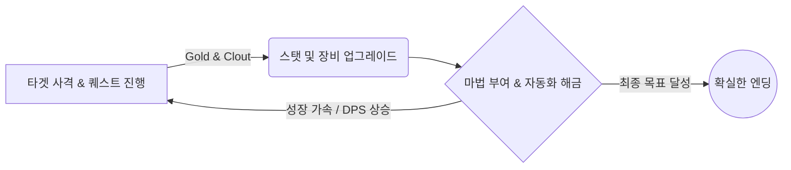

## 🎯 [Magic Archery](https://store.steampowered.com/app/2905170/Magic_Archery/) 리뷰 분석 및 기획 인사이트

### 1. 핵심 리뷰 요약 (Pros & Cons)

| 구분 | 주요 피드백 | 게임 기획적 의미 (Takeaways) |
| --- | --- | --- |
| **👍 장점** | **완벽한 페이스 조절:** 약 45분~1시간 15분의 짧은 플레이 타임 내에 퀘스트와 업그레이드 트리가 동시에 맞물려 끝남. | 무한 방치형보다 **명확한 엔딩이 있는 숏폼 증분 게임**이 유저에게 강렬한 성취감을 제공함. |
|  | **본연의 도파민 자극:** "숫자가 올라가는" 장르 특유의 재미와 즉각적인 성장 체감을 매우 잘 구현함. | 직관적인 UI와 능동적(Active)인 클릭 및 성장 루프 설계의 중요성. |
|  | **시청각적 피드백:** 화살의 종류마다 다른 사운드 이펙트를 적용해 타격감의 차이를 부여함. | 2D 그래픽 환경에서도 사운드를 통한 감각적 피드백이 몰입도를 크게 높임. |
| **👎 단점** | **극심한 볼륨 부족:** 대다수의 유저가 "돈을 지불할 테니 더 긴 버전을 만들어 달라"고 요청할 정도로 콘텐츠가 짧음. | 코어 루프가 성공적이라면 유료화나 후속작을 통한 확장 잠재력이 매우 큼. |
|  | **특정 스킬 OP화:** 후반부 '포탈 화살(Portal arrows)'에 마법 수치가 쌓이면 다른 화살 업그레이드가 무의미해지는 밸런스 붕괴 구간 존재. | 재화가 누적될 때 발생하는 스노우볼링 및 버려지는 하위 스킬에 대한 밸런스 테스트 필요. |

---

### 2. 증분 게임 기획을 위한 벤치마크 포인트

커뮤니티에서 공통으로 제안된 개선 아이디어 중, 새로운 증분 게임 개발에 즉시 적용하기 좋은 핵심 요소들입니다.

* **디테일한 통계 화면 (Stats Screen)**
* 엔딩 직후 '부순 타겟 수', '화살 종류별 누적 데미지', '초당 최대 데미지(DPS)', '누적 소모 골드' 등의 상세 통계를 제공하여 유저의 플레이 여정을 구체적인 수치로 시각화.

* **세계관이 결합된 프레스티지(Prestige) 환생 시스템**
* 단순한 능력치 초기화가 아닌, "선대 궁수의 피를 이어받은 자손"이 되어 플레이하는 방식의 스토리텔링형 환생 시스템을 도입하면 짧은 볼륨의 한계를 극복하고 리플레이 가치를 부여할 수 있음.

* **제약 플레이 업적 (Handicap Achievements)**
* "특정 타겟을 구매하지 않고 엔딩 보기", "자동화 기능 없이 클리어하기" 등의 히든 업적을 추가하여 코어 유저들의 파고들기(Min-Maxing) 욕구 자극.

---

### 3. 코어 게임플레이 루프 구조

---

**💡 핵심 요약**
[Magic Archery](https://store.steampowered.com/app/2905170/Magic_Archery/)는 끝없이 늘어지는 기존 방치형 게임의 문법을 비틀어, **1시간 내외의 명확한 엔딩과 치밀하게 맞물리는 성장 페이스**로 호평을 받은 작품입니다. 타격감을 살린 시청각적 피드백과 플레이어의 달성감을 극대화하는 디테일한 통계/업적 시스템을 차기작 기획에 벤치마킹하신다면 완성도 높은 결과를 얻으실 수 있을 것입니다.